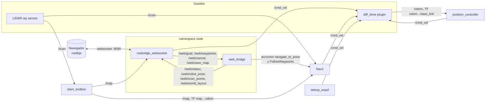

# Robot diferencial en ROS 2 Foxy

Robot móvil de tracción diferencial simulado en Gazebo Classic. El proyecto va
de la definición del robot (URDF/XACRO con LiDAR 2D) hasta la navegación
autónoma con SLAM y Nav2, y se maneja desde una interfaz web hecha con
rosbridge y roslibjs.

**Qué incluye:**
- **Modelo y mundo:** robot diferencial con LiDAR 2D (URDF/XACRO) y una arena propia de 10 × 10 m con obstáculos.
- **Arranque y control:** un launch único que abre la simulación, RViz2, el controlador de posición y la teleoperación WASD.
- **Validación:** una fase de validación de hardware simulado que prueba sensores, actuadores y controlador, y entrega un informe.
- **Mapa y navegación:**
  - mapeo con `slam_toolbox`;
  - navegación autónoma con Nav2 a cualquier punto (x, y), esquivando obstáculos;
  - llegada precisa: 5 cm en posición y unos 3° en orientación.
- **Interfaz web:** teleoperación, LiDAR en tiempo real, mapa (plano o SLAM), metas y rutas por clic o coordenadas, herramientas de SLAM, volver al inicio y apagado del sistema.

---

## Requisitos

| | Versión |
|---|---|
| Sistema operativo | Ubuntu 20.04 (también funciona en **WSL2** con Windows 11) |
| ROS 2 | Foxy Fitzroy |
| Simulador | Gazebo Classic 11 |
| Navegador | Cualquiera moderno (Chrome, Edge, Firefox) |

La interfaz web carga `roslibjs` y las fuentes desde internet (CDN), así que el
navegador necesita conexión.

## Instalación

### 1. ROS 2 Foxy

Si todavía no está instalado, sigue la
[guía oficial](https://docs.ros.org/en/foxy/Installation/Ubuntu-Install-Debians.html)
(paquete `ros-foxy-desktop`).

### 2. Dependencias del proyecto

```bash
sudo apt update
sudo apt install -y \
  ros-foxy-gazebo-ros-pkgs ros-foxy-xacro \
  ros-foxy-robot-state-publisher ros-foxy-joint-state-publisher \
  ros-foxy-slam-toolbox ros-foxy-navigation2 ros-foxy-nav2-bringup \
  ros-foxy-rosbridge-suite \
  python3-colcon-common-extensions python3-rosdep xterm
```

`xterm` hace falta porque la teleoperación WASD se abre en una ventana aparte.

### 3. Workspace

```bash
mkdir -p ~/ros2_ws && cd ~/ros2_ws
git clone https://github.com/JuanJose2805/robotics40-robot-diferencial.git .
source /opt/ros/foxy/setup.bash

# Revisa que no falte ninguna dependencia declarada en los package.xml
sudo rosdep init 2>/dev/null; rosdep update --include-eol-distros
rosdep install --from-paths src --ignore-src -y --rosdistro foxy

colcon build
source install/setup.bash
```

Foxy ya no tiene soporte oficial, por eso `rosdep update` necesita
`--include-eol-distros`.

Para no repetir los `source` en cada terminal:
```bash
echo "source /opt/ros/foxy/setup.bash" >> ~/.bashrc
echo "source ~/ros2_ws/install/setup.bash" >> ~/.bashrc
```

---

## Uso

Cada launch levanta todo lo que necesita. No hace falta abrir nada antes.

| Comando | Qué levanta |
|---|---|
| `ros2 launch robot_web web.launch.py` | **Todo el sistema + interfaz web** (navegación sobre el mapa guardado) |
| `ros2 launch robot_web web.launch.py mode:=slam` | Interfaz web + mapeo con SLAM + Nav2 para explorar |
| `ros2 launch robot_web web.launch.py mode:=sim` | Interfaz web + solo la simulación (teleoperación y LiDAR) |
| `ros2 launch robot_bringup bringup.launch.py` | Simulación, RViz2, controlador de posición y teleop WASD |
| `ros2 launch robot_bringup validation.launch.py` | Validación de hardware simulado con informe |
| `ros2 launch robot_navigation slam.launch.py` | Mapeo con SLAM manejando con WASD (RViz2) |
| `ros2 launch robot_navigation navigation.launch.py` | Navegación autónoma con Nav2 (RViz2) |
| `ros2 launch robot_description display.launch.py` | Solo el modelo en RViz2 (sin Gazebo) |

**Cerrar todo:** con **Ctrl+C** en la ventana de teleoperación, cerrando esa
ventana, o con **Apagar sistema** en la interfaz web. Cualquiera de las tres
cierra todo el launch, Gazebo incluido.

### Interfaz web

```bash
ros2 launch robot_web web.launch.py
```

Después abre **http://localhost:8000** en el navegador. En WSL2 se abre desde
el navegador de Windows sin configurar nada, porque `localhost` se reenvía a
Ubuntu.

- **Conducción:**
  - botones W A S D, o el teclado (WASD, flechas, espacio para frenar);
  - velocidades ajustables con los deslizadores;
  - mover el robot a mano cancela la navegación en curso.
- **LiDAR:**
  - vista polar en tiempo real con el obstáculo más cercano;
  - los impactos también se dibujan en rojo sobre el mapa.
- **Mapa:**
  - capas **Plano** (dibujado a partir del `.world` de Gazebo), **SLAM** (el mapa que construyó el robot) o **Ambos**;
  - la vista se puede girar; por defecto x apunta hacia arriba, como la cámara cenital de Gazebo.
- **Navegación:**
  - una meta se da con un clic sobre el mapa; si arrastras, eliges hacia dónde mira el robot al llegar;
  - también se puede dar escribiendo x, y y θ;
  - **Agregar a la ruta** arma una lista de waypoints y **Recorrer la ruta** la ejecuta;
  - **Volver al inicio** regresa el robot a la pose del spawn.
- **Herramientas de SLAM** (solo en modo `slam`):
  - pausar y reanudar el mapeo;
  - guardar el mapa en `~/maps/<nombre>` (imagen `.pgm/.yaml` y grafo de poses).
- **Apagar sistema:** cierra todo. Pide un segundo clic para confirmar.

### Mapear y navegar con un mapa nuevo

1. Lanza `ros2 launch robot_web web.launch.py mode:=slam`.
2. Recorre la arena, con WASD o con metas por clic.
3. Escribe un nombre en **Guardar el mapa como** y pulsa **Guardar**.
4. Navega sobre ese mapa:
   ```bash
   ros2 launch robot_navigation navigation.launch.py map:=$HOME/maps/<nombre>
   ```

El mapa de la arena ya viene guardado en `src/robot_navigation/maps/`, y
`navigation.launch.py` lo usa por defecto.

### Validación de hardware simulado

```bash
ros2 launch robot_bringup validation.launch.py
```

Abre la simulación sin teleoperación, para que nadie mueva el robot durante
las pruebas, y ejecuta `hardware_validation`, que hace tres bloques de
pruebas:
1. **Sensores:** frecuencia y datos coherentes de `/scan`, `/odom` y `/joint_states`.
2. **Actuadores:** las órdenes W/S/A/D en `/cmd_vel` se comparan con la velocidad medida en cada rueda y con el movimiento real del chasis.
3. **Controlador de posición:** metas en varias direcciones y cancelación a mitad de camino.

Al final imprime un informe **APROBADO / FALLA** y termina con código 0 o 1.

---

## Arquitectura

### Paquetes

| Paquete | Responsabilidad |
|---|---|
| `robot_description` | Modelo URDF/XACRO: chasis, ruedas, rueda loca y LiDAR 2D. Plugins de Gazebo (diff drive, ray sensor). |
| `robot_gazebo` | Mundo `arena.world` y launch que abre Gazebo y hace aparecer al robot. |
| `robot_control` | Controlador de posición, teleoperación WASD y validación de hardware. |
| `robot_bringup` | Launch único de la simulación y launch de validación. |
| `robot_navigation` | SLAM (`slam_toolbox`), localización y Nav2: parámetros, árbol de comportamiento, mapas. |
| `robot_web` | Interfaz web: página, nodo puente `web_bridge` y launch con rosbridge. |

Cada paquete depende solo de los de abajo:
`robot_web → robot_navigation → robot_bringup → robot_control / robot_gazebo → robot_description`.

### Nodos y tópicos



- **`/cmd_vel`:** lo pueden publicar la teleoperación, el controlador de posición, Nav2 o la web. Para evitar choques, en los modos de navegación no se arranca el controlador de posición, y mover el robot a mano desde la web cancela la meta activa.
- **Namespace `/web`:** todos los tópicos propios de la interfaz viven ahí (`/web/goal`, `/web/status`…), separados de los del robot. Los nodos de la web también, y por eso al nodo puente se le remapea `tf` → `/tf`: el listener de TF de Foxy usa nombres relativos.
- **Controlador de posición:** sus entradas y salidas usan el nombre del nodo (`/position_controller/goal`, `goal_xy`, `cancel`, `status`).

### Árbol de TF

```
map ──(slam_toolbox)──> odom ──(diff_drive)──> base_link ─┬─> base_footprint
                                                          ├─> lidar_link
                                                          ├─> left_wheel_link / right_wheel_link
                                                          └─> caster_link
```

`base_footprint` está en el suelo, bajo el eje de las ruedas: es el punto sobre
el que gira un robot diferencial (REP-105), y Nav2 lo usa como referencia del
robot. Como el chasis (`base_link`) está 10 cm por delante del eje, cuando el
robot está en el spawn (0, 0) la interfaz muestra x = −0.10. Esa es la
posición correcta del eje de las ruedas.

### Decisiones de diseño

- **Controlador de posición propio** (`robot_control/go_to_goal.py`):
  - control por estados: girar, avanzar, alinear;
  - ley de control polar sobre la cinemática diferencial;
  - deceleración limitada para no patinar;
  - la lógica es pura y está separada del nodo ROS, con pruebas unitarias.
- **Localización con `slam_toolbox` en vez de AMCL:** con la odometría ideal de la simulación, AMCL divergía (saltos de decenas de grados). `slam_toolbox` en modo localización carga el grafo de poses guardado y corrige con precisión de milímetros.
- **Nav2 ajustado al robot:**
  - huella rectangular;
  - crítico `ObstacleFootprint`, que revisa toda la huella (`BaseObstacle` solo revisa el centro);
  - inflación de 0.60 m;
  - tolerancias de llegada de 5 cm y 0.05 rad.
- **Árbol de comportamiento propio:** es el de Foxy con `server_timeout` de 1 s. El valor fijo de 10 ms de Foxy provocaba `send_goal failed` en equipos cargados.
- **Nodo `web_bridge`:** el rosbridge de Foxy no maneja acciones de ROS 2 ni lee TF, así que este nodo:
  - recibe las metas de la web y se las pasa a Nav2;
  - publica la pose del robot y los puntos del LiDAR ya en el marco `map`, calculados con la TF del instante de cada medida;
  - guarda mapas;
  - lee el plano del `.world`.
- **Interfaz web modular:**
  - `ros.js`: conexión y nombres de tópicos;
  - `map_view.js`: mapa;
  - `lidar_view.js`: vista polar del LiDAR;
  - `teleop.js`: teleoperación;
  - `app.js`: une los módulos.

### Estructura del repositorio

```
src/
├── robot_description/   urdf/robot.urdf.xacro, rviz/, launch/display.launch.py
├── robot_gazebo/        worlds/arena.world, launch/arena.launch.py
├── robot_control/       position_controller, go_to_goal, teleop_wasd, hardware_validation
├── robot_bringup/       launch/bringup.launch.py, launch/validation.launch.py
├── robot_navigation/    config/ (Nav2, slam_toolbox), behavior_trees/, maps/, launch/
└── robot_web/           web/ (HTML, CSS, JS), robot_web/web_bridge.py, launch/web.launch.py
```

### Pruebas y estilo

```bash
colcon test && colcon test-result --verbose
```

Corre los linters de ament (`flake8`, `pep257`, `copyright`) y las pruebas
unitarias del controlador y del puente web.

---

## Solución de problemas

- **La página no conecta (rosbridge en gris):** espera unos segundos a que arranque todo. La página se reconecta sola. Si cambiaste los archivos de la web, recarga con **Ctrl+F5**.
- **Gazebo quedó abierto después de cerrar:** ejecuta `pkill -KILL -f gzclient; pkill -KILL -f gzserver`.
- **`Address already in use` en el puerto 8000 o 9090:** quedó un proceso de una ejecución anterior. Ciérralo, o cambia el puerto con `web_port:=8001` o `rosbridge_port:=9091`.
- **El robot no llega a una meta:** la meta tiene que estar dentro de la arena y lejos de los obstáculos (fuera de la zona inflada). La página rechaza los puntos fuera de la arena.

## Licencia

Apache 2.0. Ver [LICENSE](LICENSE).
